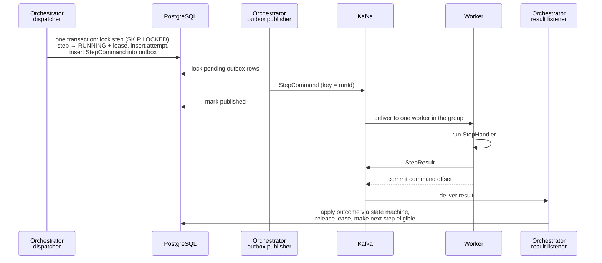

# FlowForge

[](https://github.com/LouayChayeb/flowforge/actions/workflows/ci.yml)

**A durable workflow execution engine that runs multi-step jobs reliably — even when processes crash, messages are duplicated, or downstream services are unavailable.**

FlowForge is a compact, explicit take on the durable-execution model used by workflow orchestration platforms such as Temporal. It does not aim to compete with them on features. Its goal is to implement — and prove with tests — the hard parts of reliable distributed execution:

- transaction boundaries between a database and a message broker (transactional outbox)
- at-least-once delivery and idempotent processing
- an explicit step state machine with concurrency control
- leases, retries with backoff, and recovery after process failure
- saga-style compensation for partially completed business operations

> **Status:** Phase 4 complete. Commands go through a transactional outbox, running steps hold leases, failed runs are compensated, and a [consistency checker](docs/correctness.md) verifies ten invariants of the execution history. They hold under a stress test with concurrent engine instances, duplicated and late messages, and lease races, and in a live run with two orchestrators, three workers and a killed worker. See the [crash-recovery demo](docs/recovery-demo.md) and the [roadmap](#roadmap).

---

## The problem

An e-commerce order has to be validated, inventory reserved, the payment charged, a shipment created and a confirmation sent. Written as plain method calls:

```java
validateOrder(order);
reserveInventory(order);
chargePayment(order);
createShipment(order);
sendConfirmation(order);
```

If the process crashes right after `chargePayment`, what happens on restart? Start over and charge the customer twice? Skip ahead and lose track of the reservation? And what if the payment call *timed out* but the charge actually went through?

FlowForge is the machinery that remembers what should happen, records what has happened, decides what to retry, and resumes safely after an interruption.

## How it works


| Component | Responsibility |
|---|---|
| **Orchestrator** (`flowforge-orchestrator`) | REST API, workflow definitions, the step state machine, scheduling the next eligible step, recovery |
| **PostgreSQL** | Durable source of truth: definitions, runs, step executions, attempt history, outbox |
| **Kafka** | Transports step commands to workers and results back. It moves messages; it is *not* the workflow engine |
| **Workers** (`flowforge-worker`) | Execute individual steps (validate, reserve, charge, ship, notify) and report outcomes |
| **Common** (`flowforge-common`) | Message contracts shared by orchestrator and workers |

More detail, including how each failure mode is handled, is in [docs/architecture.md](docs/architecture.md).

## API

| Method | Path | Purpose |
|---|---|---|
| `POST` | `/api/workflows` | Register a workflow definition; posting an existing name registers its next version |
| `GET` | `/api/workflows/{name}` | Latest version of a definition |
| `POST` | `/api/workflows/{name}/runs` | Start a run; returns `202 Accepted` immediately with a `Location` to poll |
| `GET` | `/api/runs/{runId}` | Run status, every step's state and the full attempt history |
| `GET` | `/api/admin/consistency` | Check the stored history against FlowForge's [invariants](docs/correctness.md); `?workflow=` to narrow it |

Errors are returned as RFC 9457 problem details (`application/problem+json`).

**1. Register a workflow** ([example file](docs/examples/order-processing.json)):

```bash
curl -X POST localhost:8080/api/workflows -H "Content-Type: application/json" \
     -d @docs/examples/order-processing.json
```

**2. Start a run:**

```bash
curl -i -X POST localhost:8080/api/workflows/order-processing/runs -H "Content-Type: application/json" \
     -d '{"input": {"orderId": "ORD-1042", "customerId": "CUS-91", "amount": 249.90}}'
```

```json
{ "runId": "7c0e…", "workflow": "order-processing", "version": 1, "status": "RUNNING" }
```

**3. Follow it:**

```bash
curl localhost:8080/api/runs/7c0e…
```

```json
{
  "runId": "7c0e…",
  "workflow": "order-processing",
  "status": "COMPLETED",
  "currentStep": null,
  "steps": [
    { "name": "validate-order",    "type": "VALIDATE_ORDER",    "status": "COMPLETED", "attemptCount": 1, "attempts": [ … ] },
    { "name": "reserve-inventory", "type": "RESERVE_INVENTORY", "status": "COMPLETED", "attemptCount": 1, "attempts": [ … ] },
    { "name": "charge-payment",    "type": "CHARGE_PAYMENT",    "status": "COMPLETED", "attemptCount": 1, "attempts": [ … ] },
    { "name": "create-shipment",   "type": "CREATE_SHIPMENT",   "status": "COMPLETED", "attemptCount": 1, "attempts": [ … ] },
    { "name": "send-confirmation", "type": "SEND_CONFIRMATION", "status": "COMPLETED", "attemptCount": 1, "attempts": [ … ] }
  ]
}
```

The sample handlers are simulated. Three inputs show the failure paths:

| Input | What happens | Final run status |
|---|---|---|
| `"amount": 0` | `validate-order` fails permanently; nothing to undo | `FAILED` |
| `"amount": 50000` | `charge-payment` is declined after inventory was reserved → `RELEASE_INVENTORY` runs | `COMPENSATED` |
| `"country": "XX"` | `create-shipment` fails after reserve and charge → `REFUND_PAYMENT`, then `RELEASE_INVENTORY` | `COMPENSATED` |

Steps opt into compensation with `"compensateWith": "<STEP_TYPE>"` in the definition. Compensations appear in the run's `steps` with `"kind": "COMPENSATION"`, and go through the same retries and leases as forward steps. If a compensation itself fails, the run ends `COMPENSATION_FAILED` for manual attention.

## How a step executes



1. **Claim:** the dispatcher locks eligible steps with `SELECT … FOR UPDATE SKIP LOCKED`, moves them to `RUNNING` with a lease, opens an attempt row and writes the `StepCommand` to the **outbox** — all in one transaction. There is no moment where the database says "dispatched" but no command exists.
2. **Publish:** the outbox publisher sends pending commands to `flowforge.step-commands` (keyed by run id, so a run's messages stay ordered) and marks them published. If Kafka is down, commands wait in the outbox and go out when it is back.
3. **Execute:** one worker in the `flowforge-workers` consumer group runs the handler, publishes a `StepResult` to `flowforge.step-results`, and only then commits the command's offset (at-least-once).
4. **Record:** the orchestrator applies the result through the state machine:
   - success makes the next step eligible, or completes the run
   - a retryable failure schedules a retry with exponential backoff, or fails the step once attempts run out
   - a permanent failure fails the step immediately
   - a failed step compensates the completed steps that declare a compensation, in reverse order
5. **Recover:** a sweeper times out `RUNNING` steps whose lease expired without a result (worker died, command lost) and retries them like any retryable failure.

Every state change is validated (terminal states can never be left), results must name the attempt they belong to, and every entity carries an optimistic-lock version. A duplicated or late result names an attempt that is no longer active, so it is rejected and dropped without touching state.

## Failure semantics

| What goes wrong | What FlowForge does |
|---|---|
| Orchestrator dies between claiming a step and publishing its command | The command was committed to the outbox with the claim; the publisher sends it after restart |
| Kafka is unavailable | Commands stay in the outbox and are published when it recovers |
| Outbox publisher sends a command, then dies before marking it published | The command is sent again; the duplicate result is rejected as stale |
| Worker dies mid-step | Its uncommitted command is redelivered to another worker; if no result arrives, the lease expires and the step is retried |
| A result and a lease expiry race for the same attempt | Both lock the step row first; exactly one wins, the other is rejected as stale |
| Workers fall behind and commands outlive their lease | Each command carries its lease deadline; workers skip expired commands instead of doing wasted work |
| A result arrives twice, or late from a timed-out attempt | Rejected: it does not name the step's active attempt |
| A step keeps failing | Bounded retries with exponential backoff, then the step fails |
| A later step fails permanently | Completed steps are compensated in reverse order |

What it does **not** guarantee: an external side effect (a charge, an email) can execute more than once if a worker dies after doing it and before reporting it. Handlers receive a stable `stepExecutionId` to use as an idempotency key with the external system; that is the only way to make such a side effect exactly-once.

## Tech stack

| Technology | Used for |
|---|---|
| Java 17 + Spring Boot 3 | Orchestrator API, orchestration logic, workers |
| Spring Data JPA + Hibernate | Persistence mapping and transactional operations |
| PostgreSQL + Flyway | Durable workflow state, versioned schema migrations |
| Apache Kafka | Asynchronous step commands and results |
| Testcontainers | Integration tests against real PostgreSQL and Kafka |
| Docker / Docker Compose | Reproducible local infrastructure and images |
| Kubernetes + Helm | Deploying, restarting and scaling orchestrator and workers |
| GitHub Actions | Build and test on every push |

## Getting started

**Prerequisites:** JDK 17+, Docker Desktop.

```bash
# 1. Start PostgreSQL, Kafka and Kafka UI
docker compose up -d

# 2. Build and run all tests
./mvnw verify

# 3. Install the modules so each one can be run on its own
./mvnw install -DskipTests

# 4. Run the orchestrator (http://localhost:8080)
./mvnw -pl flowforge-orchestrator spring-boot:run

# 5. Run one or more workers, each in its own terminal
./mvnw -pl flowforge-worker spring-boot:run
./mvnw -pl flowforge-worker spring-boot:run -Dspring-boot.run.arguments=--server.port=8082
```

On Windows use `mvnw.cmd` instead of `./mvnw`. If port 8080 is taken, start the orchestrator with `-Dspring-boot.run.arguments=--server.port=8085`.

Kafka distributes the three partitions of `flowforge.step-commands` across the running workers. Start or stop workers while runs are in progress and watch the partitions rebalance in Kafka UI.

| Service | URL |
|---|---|
| Orchestrator health | http://localhost:8080/actuator/health |
| Worker health | http://localhost:8081/actuator/health |
| Kafka UI | http://localhost:8090 |
| PostgreSQL | `localhost:5432`, db/user/password `flowforge` |

## Project structure

```
flowforge/
├── flowforge-common/          # Messages (StepCommand, StepResult, Topics), StepHandler SPI, StepCommandProcessor
├── flowforge-orchestrator/    # REST API, state machine, dispatcher, persistence
│   └── src/main/java/…/orchestrator/
│       ├── api/               # Controllers, DTOs, error handling
│       ├── definition/        # Workflow definitions and versioning
│       ├── run/               # Runs, step executions, attempts, state machine
│       ├── engine/            # Claiming, result listener, lease recovery, retry policy, scheduler, metrics
│       ├── outbox/            # Transactional outbox and its publisher
│       └── consistency/       # Invariant checker behind /api/admin/consistency
├── flowforge-worker/          # Kafka command listener
│   └── src/main/java/…/worker/handlers/   # Sample order-processing step handlers
├── docs/                      # Architecture and design notes
├── docker-compose.yml         # Local PostgreSQL + Kafka + Kafka UI
└── .github/workflows/ci.yml   # Build and test pipeline
```

## Roadmap

- [x] **Phase 0 — Scaffold:** multi-module build, local infrastructure, CI
- [x] **Phase 1 — Core engine (no Kafka):** workflow definitions, runs, sequential step execution, explicit state machine, persisted transitions, run status API
- [x] **Phase 2 — Asynchronous execution:** move steps to worker processes; commands and results over Kafka; consumer groups and partitioning
- [x] **Phase 3 — Durability and recovery:** transactional outbox, idempotent consumers, bounded retries with exponential backoff, leases and a recovery sweeper, compensation — plus the [crash-recovery demo](docs/recovery-demo.md)
- [x] **Phase 4 — Concurrency and correctness:** multiple workers and orchestrators on the same workload; a consistency checker, a lease-race test and a chaos stress test prove no double-claiming and no stale-message corruption — see [docs/correctness.md](docs/correctness.md)
- [ ] **Phase 5 — Deployment and performance:** Docker images, Helm chart, Minikube deployment, throughput/latency measurements, documented guarantees and limits

## License

[MIT](LICENSE)
