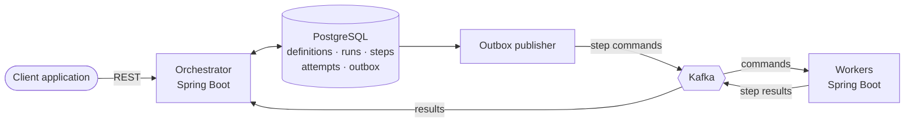

# FlowForge

[](https://github.com/LouayChayeb/flowforge/actions/workflows/ci.yml)

**A durable workflow execution engine that runs multi-step jobs reliably — even when processes crash, messages are duplicated, or downstream services are unavailable.**

FlowForge is a compact, explicit take on the durable-execution model used by workflow orchestration platforms such as Temporal. It does not aim to compete with them on features. Its goal is to implement — and prove with tests — the hard parts of reliable distributed execution:

- transaction boundaries between a database and a message broker (transactional outbox)
- at-least-once delivery and idempotent processing
- an explicit step state machine with concurrency control
- leases, retries with backoff, and recovery after process failure
- saga-style compensation for partially completed business operations

> **Status:** early development — project scaffold in place, Phase 1 (the core engine) in progress. See the [roadmap](#roadmap).

---

## The problem

An e-commerce order has to be validated, inventory reserved, the payment charged, a shipment created and a confirmation sent. Written as plain method calls:

```java
validateOrder(order);
reserveInventory(order);
chargePayment(order);
createShipment(order);
sendConfirmation(order);
```

If the process crashes right after `chargePayment`, what happens on restart? Start over and charge the customer twice? Skip ahead and lose track of the reservation? And what if the payment call *timed out* but the charge actually went through?

FlowForge is the machinery that remembers what should happen, records what has happened, decides what to retry, and resumes safely after an interruption.

## How it works



| Component | Responsibility |
|---|---|
| **Orchestrator** (`flowforge-orchestrator`) | REST API, workflow definitions, the step state machine, scheduling the next eligible step, recovery |
| **PostgreSQL** | Durable source of truth: definitions, runs, step executions, attempt history, outbox |
| **Kafka** | Transports step commands to workers and results back. It moves messages; it is *not* the workflow engine |
| **Workers** (`flowforge-worker`) | Execute individual steps (validate, reserve, charge, ship, notify) and report outcomes |
| **Common** (`flowforge-common`) | Message contracts shared by orchestrator and workers |

More detail, including how each failure mode is handled, is in [docs/architecture.md](docs/architecture.md).

## API preview

Start a run:

```http
POST /api/workflows/order-processing/runs
Content-Type: application/json

{ "input": { "orderId": "ORD-1042", "customerId": "CUS-91", "amount": 249.90 } }
```

```json
{ "runId": "run-8f31", "workflow": "order-processing", "status": "RUNNING" }
```

Query it:

```http
GET /api/runs/run-8f31
```

```json
{
  "runId": "run-8f31",
  "status": "RUNNING",
  "currentStep": "CREATE_SHIPMENT",
  "steps": [
    { "name": "VALIDATE_ORDER",    "status": "COMPLETED" },
    { "name": "RESERVE_INVENTORY", "status": "COMPLETED" },
    { "name": "CHARGE_PAYMENT",    "status": "COMPLETED" },
    { "name": "CREATE_SHIPMENT",   "status": "RUNNING" },
    { "name": "SEND_CONFIRMATION", "status": "PENDING" }
  ]
}
```

## Tech stack

| Technology | Used for |
|---|---|
| Java 17 + Spring Boot 3 | Orchestrator API, orchestration logic, workers |
| Spring Data JPA + Hibernate | Persistence mapping and transactional operations |
| PostgreSQL + Flyway | Durable workflow state, versioned schema migrations |
| Apache Kafka | Asynchronous step commands and results |
| Testcontainers | Integration tests against real PostgreSQL and Kafka |
| Docker / Docker Compose | Reproducible local infrastructure and images |
| Kubernetes + Helm | Deploying, restarting and scaling orchestrator and workers |
| GitHub Actions | Build and test on every push |

## Getting started

**Prerequisites:** JDK 17+, Docker Desktop.

```bash
# 1. Start PostgreSQL, Kafka and Kafka UI
docker compose up -d

# 2. Build and run all tests
./mvnw verify

# 3. Run the orchestrator (http://localhost:8080)
./mvnw -pl flowforge-orchestrator spring-boot:run

# 4. Run a worker (http://localhost:8081) — in another terminal
./mvnw -pl flowforge-worker spring-boot:run
```

On Windows use `mvnw.cmd` instead of `./mvnw`.

| Service | URL |
|---|---|
| Orchestrator health | http://localhost:8080/actuator/health |
| Worker health | http://localhost:8081/actuator/health |
| Kafka UI | http://localhost:8090 |
| PostgreSQL | `localhost:5432`, db/user/password `flowforge` |

## Project structure

```
flowforge/
├── flowforge-common/          # Shared message contracts (StepCommand, StepResult)
├── flowforge-orchestrator/    # REST API, state machine, persistence, outbox, recovery
├── flowforge-worker/          # Step handlers consuming commands from Kafka
├── docs/                      # Architecture and design notes
├── docker-compose.yml         # Local PostgreSQL + Kafka + Kafka UI
└── .github/workflows/ci.yml   # Build and test pipeline
```

## Roadmap

- [x] **Phase 0 — Scaffold:** multi-module build, local infrastructure, CI
- [ ] **Phase 1 — Core engine (no Kafka):** workflow definitions, runs, sequential step execution, explicit state machine, persisted transitions, run status API
- [ ] **Phase 2 — Asynchronous execution:** move steps to worker processes; commands and results over Kafka; consumer groups and partitioning
- [ ] **Phase 3 — Durability and recovery:** transactional outbox, idempotent consumers, bounded retries with exponential backoff, leases and a recovery sweeper, compensation
- [ ] **Phase 4 — Concurrency and correctness:** multiple workers on the same workload; prove no double-claiming and no stale-message corruption
- [ ] **Phase 5 — Deployment and performance:** Docker images, Helm chart, Minikube deployment, throughput/latency measurements, documented guarantees and limits

**The goal demo:** kill a worker at a carefully chosen point, restart the system, and show that FlowForge recovers without corrupting workflow state or repeating completed operations.

## License

[MIT](LICENSE)
