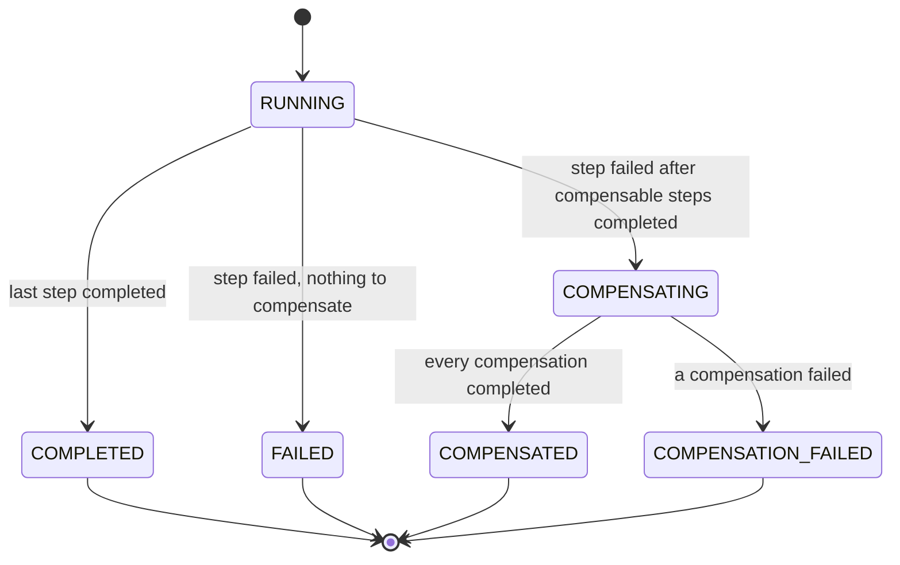
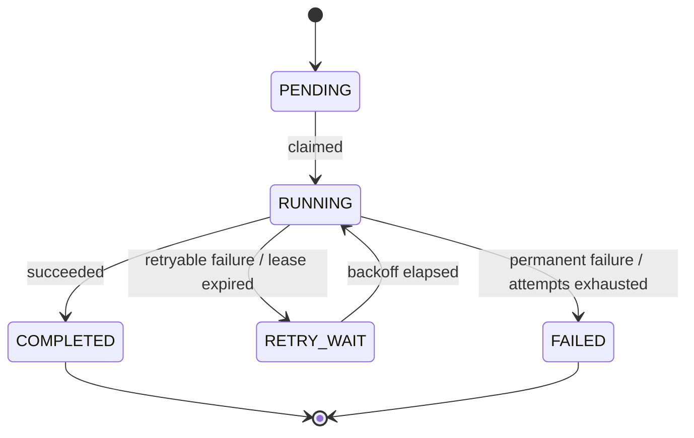

# FlowForge architecture

This document describes the design. Sections are marked with the roadmap phase in which they were implemented; everything up to Phase 4 is in place.

## Components

- **Orchestrator (control plane).** Accepts workflow definitions and run requests, owns the step state machine, decides which step is eligible next and exposes run status. It never performs slow step work inside an HTTP request: it records what must happen and returns.
- **PostgreSQL (source of truth).** Every decision the orchestrator makes is based on persisted state, so a restart loses nothing.
- **Kafka (transport).** Carries step commands to workers and step results back. Kafka distributes work; it does not decide what work should happen.
- **Workers (execution layer).** Stateless processes that execute one step attempt per command and report the outcome. Multiple instances share work through a consumer group.

## Data model (Phase 1)

| Entity | Responsibility |
|---|---|
| `WorkflowDefinition` | Named, versioned list of steps and their order |
| `WorkflowRun` | One execution of a definition with its input and overall status |
| `StepExecution` | State of one logical step within a run; stable id across retries. `kind` is `FORWARD` or `COMPENSATION`; while `RUNNING` it holds a lease (`lease_expires_at`) |
| `StepAttempt` | One execution attempt of a step: start/end time, outcome (`SUCCEEDED`, `RETRYABLE_FAILURE`, `PERMANENT_FAILURE`, `TIMED_OUT`), error |
| `OutboxEvent` | A Kafka message committed together with the state change that requires it, published afterwards (Phase 3) |

Attempt history is appended, never overwritten, so it is always possible to answer *what failed, when, how many times, and how it recovered*.

## Run state machine (Phase 3)



When a forward step fails terminally, the run walks back over the steps before it and, for each `COMPLETED` step with a `compensation_type`, appends a `COMPENSATION` step execution — most recent first. Those run sequentially through the same claim, outbox, lease and retry machinery as forward steps, with the forward step's attempt budget. `COMPENSATION_FAILED` means the system can no longer restore consistency on its own and a human has to look.

## Step state machine (Phase 1)



Every transition is validated. A terminal state (`COMPLETED`, `FAILED`) can never be left, so an old or duplicated message cannot move a completed step back to `RUNNING`. Transitions are applied with optimistic locking (a `lock_version` column) and row locks (`SELECT … FOR UPDATE SKIP LOCKED`).

## Execution loops (Phase 3)

A step is claimable when its status is `PENDING` or `RETRY_WAIT` and `next_attempt_at <= now`. Only the run's current step ever has a `next_attempt_at`, which is what keeps execution sequential. Three scheduled loops drive the engine; each locks its rows with `SKIP LOCKED`, so several orchestrator instances can run them concurrently.

| Loop | Interval (`flowforge.engine.scheduler.*`) | Transaction |
|---|---|---|
| **Dispatch** | `dispatch-interval-ms` = 500 | Lock claimable steps; transition to `RUNNING` with `lease_expires_at = now + lease-duration`; insert a `step_attempt`; insert the `StepCommand` into `outbox_event` |
| **Outbox** | `outbox-interval-ms` = 200 | Lock unpublished outbox rows; send each to Kafka and wait for the ack (`acks=all`, idempotent producer); mark published. Stops at the first failure and retries next tick |
| **Recovery** | `recovery-interval-ms` = 5000 | Find `RUNNING` steps whose lease expired; for each, in its own transaction, lock it, re-check it, mark the attempt `TIMED_OUT`, and retry or fail the step like any retryable failure |

After the outbox loop, the worker executes: it runs the `StepHandler` through `StepCommandProcessor`, publishes the `StepResult`, and then commits the command offset. Unknown step types are permanent failures; exceptions are retryable. A command that arrives after its `deadline` (the attempt's lease expiry) is skipped, since the orchestrator will time that attempt out anyway. The result listener then locks the step (`SELECT … FOR UPDATE`) and applies the result; the attempt number must match the step's current attempt, otherwise the result is discarded as stale. Because recovery locks the step too, a result and a lease expiry for the same attempt are applied one after the other, and the second is rejected. See [correctness.md](correctness.md).

Retry backoff is `initial-backoff * multiplier^(attempt-1)`, capped at `max-backoff` (defaults: 1 s, ×2, 1 min), configured under `flowforge.engine.retry`. The lease (`flowforge.engine.lease-duration`, default 60 s) must exceed the slowest step plus the time a command can wait in Kafka; a shorter lease causes spurious timeouts, which are safe (the late result is rejected) but waste an attempt.

The orchestrator does not validate step types when a definition is registered: handlers live in the workers, which the orchestrator has no registry of. A step whose type no worker handles fails permanently on its first attempt with `No handler registered for step type …`.

## Messages

| Topic | Producer → consumer | Payload | Key |
|---|---|---|---|
| `flowforge.step-commands` | orchestrator → `flowforge-workers` group | `StepCommand` | run id |
| `flowforge.step-results` | workers → `flowforge-orchestrator` group | `StepResult` | run id |

Both topics have 3 partitions by default (`flowforge.kafka.partitions`) and are declared by both services, so either can start first. Payloads are JSON without type headers; each consumer knows the one type it reads.

`StepCommand`:

```json
{ "eventId": "…", "runId": "…", "stepExecutionId": "…", "stepName": "create-shipment",
  "stepType": "CREATE_SHIPMENT", "attempt": 1, "input": { "orderId": "ORD-1042" },
  "deadline": "2026-11-04T18:12:41.120Z" }
```

`StepResult`:

```json
{ "eventId": "…", "runId": "…", "stepExecutionId": "…", "attempt": 1, "outcome": "SUCCEEDED", "errorMessage": null }
```

Keying by run id puts all messages of one run on the same partition, so they are consumed in order.

## Failure handling

| Failure | Mechanism | Phase |
|---|---|---|
| Database commits but the Kafka publish fails | **Transactional outbox:** the state change and an outbox row are written in one transaction; a publisher sends outbox rows and marks them published. Publishing may repeat, so consumers must tolerate duplicates. | 3 |
| Kafka delivers a message more than once | **Idempotent processing:** results are matched on `stepExecutionId` + `attempt`; a result for an already-terminal step or an older attempt is ignored. External side effects use idempotency keys derived from `stepExecutionId`. | 2 (duplicate results), 3 (side effects) |
| A worker dies mid-step | **Redelivery + leases:** the worker's uncommitted command is redelivered to another worker in the group once the dead one leaves (session timeout 10 s). If no result arrives at all, the lease expires and the recovery sweeper times the attempt out and retries; a late result from the timed-out attempt is rejected. | 3 |
| A step keeps failing | **Bounded retries:** per-step attempt limits, exponential backoff, retryable vs. permanent error classification, terminal `FAILED` state. | 1 |
| A business operation partially succeeds | **Compensation (saga):** completed steps define compensating actions (e.g. release inventory) run in reverse order; compensation outcomes are recorded. | 3 |
| Two dispatchers claim the same step, or a result races a lease expiry | **Concurrency control:** claims use `SKIP LOCKED`; results and lease expiries lock the step row. Proven by the lease-race and stress tests and checked by the consistency checker ([correctness.md](correctness.md)). | 4 |
| Workers fall behind and commands outlive their lease | **Load shedding:** commands carry their lease deadline and workers skip expired ones, so a backlog drains instead of becoming a retry storm. | 4 |

## Guarantees and non-guarantees

- Internal state transitions are applied **exactly once** per logical step attempt.
- Message delivery is **at least once**.
- External side effects are **not** automatically exactly-once. They are safe only if the external operation is idempotent (accepts an idempotency key) or can be reconciled.
- Kubernetes restarting a crashed pod does not provide recovery by itself; recovery comes from persisted state, leases and the sweeper.
