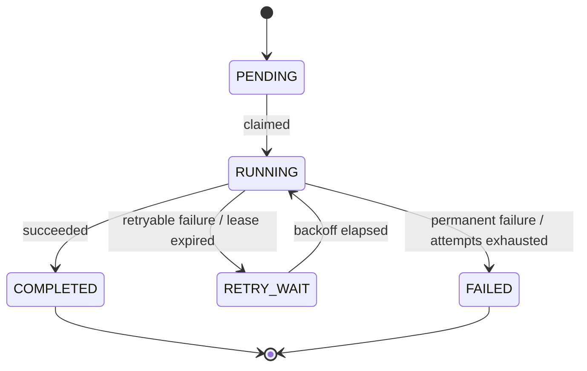

# FlowForge architecture

This document describes the target design. Sections are marked with the roadmap phase in which they are implemented.

## Components

- **Orchestrator (control plane).** Accepts workflow definitions and run requests, owns the step state machine, decides which step is eligible next and exposes run status. It never performs slow step work inside an HTTP request: it records what must happen and returns.
- **PostgreSQL (source of truth).** Every decision the orchestrator makes is based on persisted state, so a restart loses nothing.
- **Kafka (transport).** Carries step commands to workers and step results back. Kafka distributes work; it does not decide what work should happen.
- **Workers (execution layer).** Stateless processes that execute one step attempt per command and report the outcome. Multiple instances share work through a consumer group.

## Data model (Phase 1)

| Entity | Responsibility |
|---|---|
| `WorkflowDefinition` | Named, versioned list of steps and their order |
| `WorkflowRun` | One execution of a definition with its input and overall status |
| `StepExecution` | State of one logical step within a run; stable id across retries |
| `StepAttempt` | One execution attempt of a step: start/end time, worker, outcome, error |
| `OutboxEvent` | A message that must be published to Kafka (Phase 3) |

Attempt history is appended, never overwritten, so it is always possible to answer *what failed, when, how many times, and how it recovered*.

## Step state machine (Phase 1)



Every transition is validated. A terminal state (`COMPLETED`, `FAILED`) can never be left, so an old or duplicated message cannot move a completed step back to `RUNNING`. Transitions are applied with optimistic locking (a `version` column) or conditional updates (`UPDATE ... WHERE status = ? AND attempt = ?`).

## Messages

`StepCommand` (orchestrator → worker):

```json
{ "eventId": "…", "runId": "…", "stepExecutionId": "…", "stepType": "CREATE_SHIPMENT", "attempt": 1 }
```

`StepResult` (worker → orchestrator):

```json
{ "eventId": "…", "runId": "…", "stepExecutionId": "…", "attempt": 1, "outcome": "SUCCEEDED", "errorMessage": null }
```

Messages are keyed by `runId`, so all messages of one run land on the same partition and keep their order.

## Failure handling

| Failure | Mechanism | Phase |
|---|---|---|
| Database commits but the Kafka publish fails | **Transactional outbox:** the state change and an outbox row are written in one transaction; a publisher sends outbox rows and marks them published. Publishing may repeat, so consumers must tolerate duplicates. | 3 |
| Kafka delivers a message more than once | **Idempotent processing:** results are matched on `stepExecutionId` + `attempt`; a result for an already-terminal step or an older attempt is ignored. External side effects use idempotency keys derived from `stepExecutionId`. | 3 |
| A worker dies mid-step | **Leases:** a claimed attempt records a lease expiry. A recovery sweeper moves expired `RUNNING` steps to `RETRY_WAIT` and issues a new attempt; results from the stale attempt are rejected. | 3 |
| A step keeps failing | **Bounded retries:** per-step attempt limits, exponential backoff, retryable vs. permanent error classification, terminal `FAILED` state. | 3 |
| A business operation partially succeeds | **Compensation (saga):** completed steps define compensating actions (e.g. release inventory) run in reverse order; compensation outcomes are recorded. | 3 |
| Two workers claim the same step | **Concurrency control:** claims are conditional updates; only one can win. Proven with multi-worker tests. | 4 |

## Guarantees and non-guarantees

- Internal state transitions are applied **exactly once** per logical step attempt.
- Message delivery is **at least once**.
- External side effects are **not** automatically exactly-once. They are safe only if the external operation is idempotent (accepts an idempotency key) or can be reconciled.
- Kubernetes restarting a crashed pod does not provide recovery by itself; recovery comes from persisted state, leases and the sweeper.
